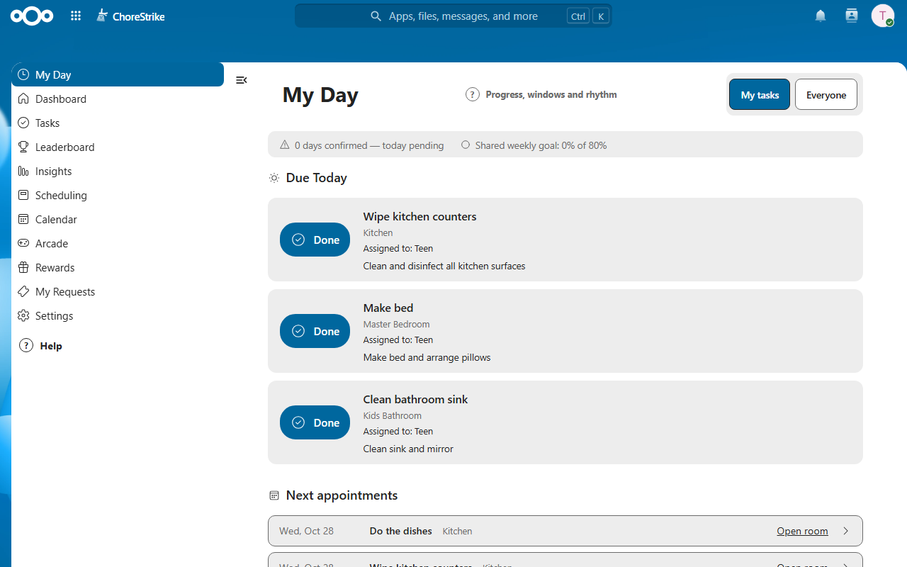
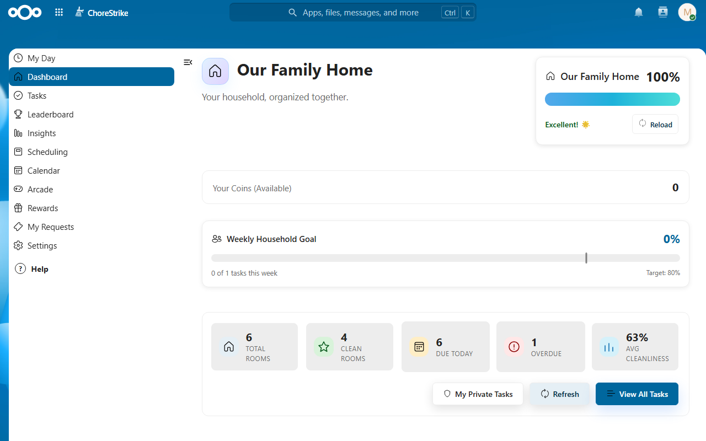
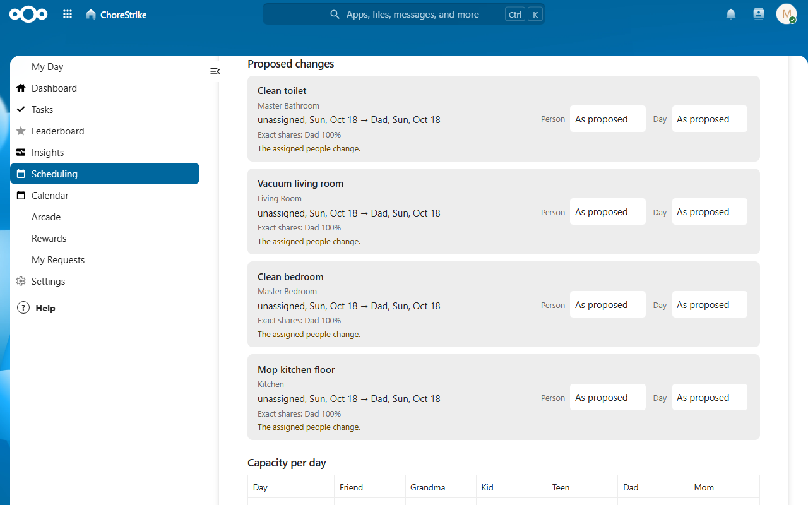
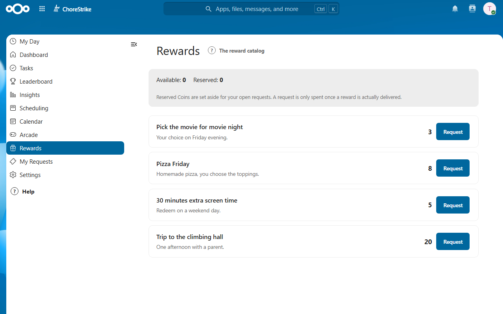

# ChoreStrike

**Shared chores, fair plans, less reminding.**

ChoreStrike is a gamified household task management app for Nextcloud.
Families and flatmates organize their home in floors and rooms, plan fair
weekly schedules, and recognize agreed work with effort-based Coins, rhythm
medals and an opt-in ranking, all inside their own Nextcloud. Planning comes
first; using the reward catalog and games is optional.

<table>
  <tr>
    <td width="50%"></td>
    <td width="50%"></td>
  </tr>
  <tr>
    <td align="center"><b>My Day</b>: today's agreed tasks</td>
    <td align="center"><b>Dashboard</b>: the household at a glance</td>
  </tr>
  <tr>
    <td width="50%"></td>
    <td width="50%"></td>
  </tr>
  <tr>
    <td align="center"><b>Weekly planner</b>: a preview, applied only once agreed</td>
    <td align="center"><b>Rewards</b>: an optional family catalog</td>
  </tr>
</table>

Screenshots: seeded demo household on Nextcloud 35, version 0.8.0-alpha.2.

New here? The [user guide](docs/user-guide.md) walks a household through
setup, everyday use and planning.

## Concept

- **One shared household**: The first person who opens the app becomes the
  owner and sets up floors and rooms with a guided wizard. Everyone else
  joins by **invitation** to the email address of their Nextcloud account —
  invite-only, no self-enrollment.
- **Fair planning**: The owner previews a weekly plan
  (who does what on which day) against each member's availability and daily
  energy budget, adjusts it, and applies it once — nothing changes until
  the plan is applied.
- **Recognition without pressure**: Coins reflect actual effort and shared
  work; rhythm progress reflects on-time agreed chores. Free days and recognized
  pauses are neutral, not missed opportunities to earn a streak.
- **Built for families**: Adults and children start in "My Day", with agreed
  tasks, next appointments and honest catch-up dates. Capacity checks, child
  limits, pauses and owner-recorded handovers support realistic planning.

## Key Features (Implemented)

- **Household structure** — floors and rooms, room cleanliness tracking,
  house health, per-house timezone for correct day boundaries.
- **Tasks** — daily/weekly/monthly recurrence with flexible windows,
  priorities, energy cost (1–5), step-by-step instructions, sub-task
  checklists, and per-task visibility (public / private / admins only).
- **Weekly planner** — availability and energy budgets per member,
  preview → adjust → apply scheduling, capacity and fairness aware, with
  child daily-task limits.
- **Execution** - My Day for every member, checklists, shared-work allocation,
  targeted undo/correction that preserves later work, and agreed catch-up and
  handover flows.
- **Recognition** - effort-only Coins with exact shared accounting, planned-day
  rhythm streaks, medals, titles, a household weekly goal and voluntary ranking.
- **Family rewards** - an optional owner-managed catalog, child requests with
  approval, adult requests, reserved balances, fulfillment and cancellation.
  Existing requests remain accessible when catalog browsing is hidden.
- **Optional arcade** - five household games with per-game highscores that
  finished chores open one by one (owners can open all); scores only, with no
  Coins, boosts or planning advantage.
- **Insights** — activity feed, member fairness table, and overcapacity
  warnings before a plan is applied.
- **Quiet defaults** - reminders, sound and celebrations are off by default.
  Personal preferences control a bounded daily Nextcloud digest and quiet hours;
  reduced-motion settings override animations.
- **Two languages** — English and German, fully translated.

Not implemented: general chore-approval workflows, external-task/CalDAV sync
or standalone mobile apps. The
[product vision](docs/concepts/product-vision.md) distinguishes the family-first
target from today's implementation. The app is free and MIT-licensed; running
a Nextcloud instance may still have hosting costs.

## Installation

### Requirements

- Nextcloud 35 primary; Nextcloud 34 is the explicitly named AIO compatibility row
- PHP 8.4.x
- MySQL/MariaDB, PostgreSQL or SQLite (via Nextcloud's database layer)

ChoreStrike is a **pre-release app (`0.8.0-alpha.2`, internal alpha)**. Its
first [retained baseline](docs/engineering/deployment.md#first-retained-baseline)
was adopted on 2026-10-17: from it, updates preserve household data — the
update to `0.8.0-alpha.2` on 2026-10-19 ran without a migration and kept every
table. Disposable development installs remain fresh-install-only; there is no
upgrade promise for them.

These bounds are the promoted current-stable baseline (CS-PLAN-082,
2026-10-06), not a pending qualification candidate: fresh NC35 installations
and the complete backend suite are verified on all three providers, and the
canonical Docker test environment provisions this pinned runtime by default
(Nextcloud 35.0.2 / PHP 8.4.26 / PostgreSQL 18.6; frozen inventory in
`docker/test-runtime.json`). AIO deployment, production rollout and
retained-baseline adoption remain separate, explicitly approved steps; see
[CS-PLAN-082](docs/plans/done/cs-plan-082-current-stable-test-baseline-and-data-preservation.md)
and the [runtime baseline note](docs/engineering/testing.md#runtime-baseline-cs-plan-082).

### Manual installation

Use the [deployment guide](docs/engineering/deployment.md) to select a verified
commit, build a production artifact, back up the target and enable the app.
Build tooling requires PHP 8.4, Composer, Node.js 24.14+ within 24.x and
npm 11.8.2+ within 11.x. The guide's generic commands need adaptation to the
actual AIO/container setup; they are not a complete AIO runbook.

Do not deploy the Docker test environment or run its seeds/resets on a family
instance. Installation and retained-baseline adoption are separate decisions.

## Getting Started

1. **Open ChoreStrike** — the first visitor becomes the owner; on the
   *Dashboard* the setup wizard guides through house name, floors and rooms,
   optional task templates from the quick-start catalog, and invitations.
2. **Invite your household** — owners invite people by the email address of
   their existing Nextcloud account and assign the role (owner, member or
   child). ChoreStrike sends no email; invited people see the shared household
   the next time they open the app.
3. **Create tasks** — owners and adult members add tasks per room (or from the
   template catalog), set recurrence and flexibility, write short
   instructions, and assign them; owners also maintain checklists.
4. **Plan the week** — in *Scheduling*, select tasks, preview a fair
   distribution across the week, adjust person/day per task, and apply.
5. **Work through My Day** — every member sees today's tasks and catch-ups,
   ticks off checklist steps, and completes a task by pressing and holding
   *Done* for 0.6 seconds (a short tap only explains the hold); undo is
   available right on the confirmation.

## Technical Stack

- **Platform**: self-hosted Nextcloud app with invite-only membership and
  role-based access. Email delivery uses your Nextcloud server's configured
  mail service.
- **Frontend**: Vue 3 (Composition API) + Pinia
- **Backend**: PHP 8.4.x (Nextcloud app framework, service architecture)
- **Database**: SQLite / MySQL / PostgreSQL (via Nextcloud DB abstraction)
- **Testing**: PHPUnit (backend), Jest (frontend), Playwright (E2E)

## Project Status

ChoreStrike is a privately maintained, non-commercial open source project,
not a hosted service.

**v0.8.0-alpha.2 — alpha pre-release.** The core household workflow (setup wizard,
invitations, tasks, scheduling, My Day, completion/undo, gamification,
insights, optional rewards and the arcade) is implemented. Cross-database
verification and repeated browser gates have passed, and this version has run
on the maintainer's family instance since 2026-10-19, where the 14-day family
trial takes place. The real-device checklist, voluntary family comprehension,
the 14-day everyday-use evidence and the final WP9 review remain open.
Automated passes are not a family-acceptance sign-off. The app is not yet
published in the Nextcloud App Store; roadmap targets are described in
[roadmap.md](docs/release/roadmap.md).

## Contact

Ask questions in
[GitHub Discussions](https://github.com/ChoreStrike/ChoreStrike/discussions/categories/q-a).
For non-sensitive bug reports and feature requests, see
[Contributing](docs/CONTRIBUTING.md).

Report security vulnerabilities privately through GitHub as described in the
[security policy](docs/SECURITY.md), not in a public issue or discussion. Do
not include passwords, tokens or real household data in posts or attachments.

## Contributing

ChoreStrike is an open source project (MIT) and welcomes contributions —
code, design, translations and ideas. See [CONTRIBUTING.md](docs/CONTRIBUTING.md).
The repository lives at
[github.com/ChoreStrike/ChoreStrike](https://github.com/ChoreStrike/ChoreStrike);
non-sensitive bugs and feature requests belong in its
[issue tracker](https://github.com/ChoreStrike/ChoreStrike/issues).

## Documentation

### Using ChoreStrike

- [User guide](docs/user-guide.md) - Setup, everyday use, planning and optional features
- [Security](docs/SECURITY.md) - Vulnerability reporting policy

### Developing ChoreStrike

- [Architecture](docs/engineering/architecture.md) - System design overview
- [API Documentation](docs/api/README.md) - REST API endpoints
- [App security architecture](docs/standards/guidelines/security.md) - Authorization and validation rules
- [Deployment](docs/engineering/deployment.md) - Installation and deployment guide
- [Testing](docs/engineering/testing.md) - Testing strategies
- [Roadmap](docs/release/roadmap.md) - Release planning
- [Contributing](docs/CONTRIBUTING.md) - How to contribute
- [Third-party code & assets](docs/THIRD_PARTY.md) - Vendored libraries and licences

---

Made with ❤️ for cleaner homes and happier households
