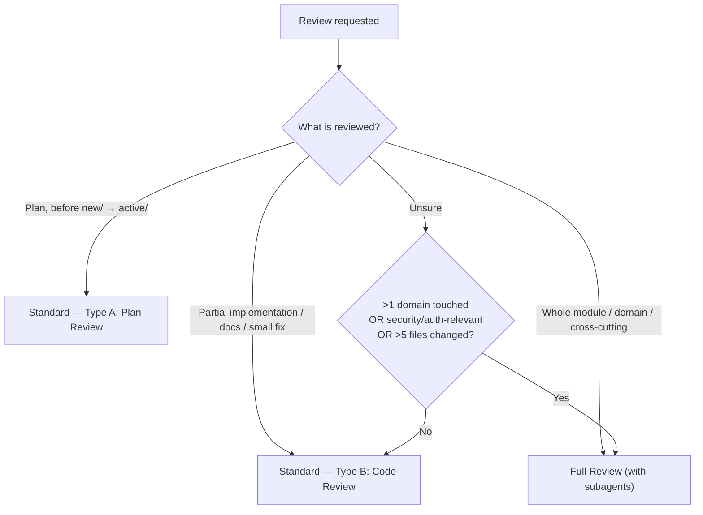
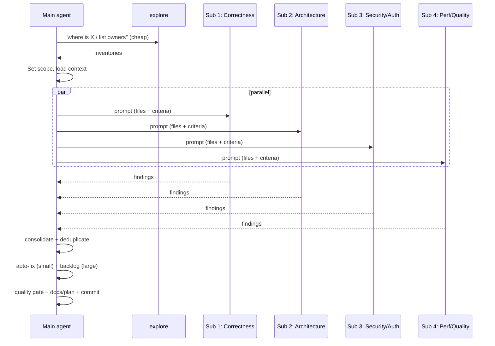
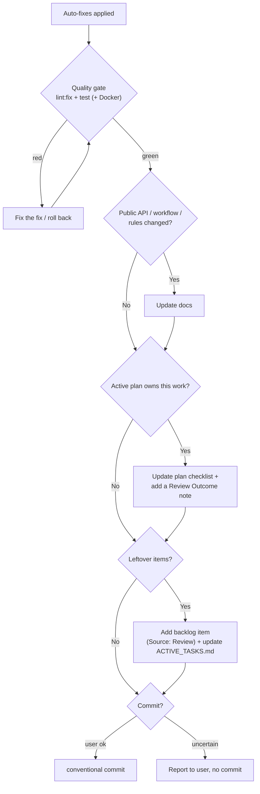

# Review — Standard & Full Review Process

> Canonical review process for ChoreStrike. Loaded automatically when a review is
> requested, or via the slash commands `/review-chorestrike`,
> `/review-chorestrike-full`, `/plan-review`. Read [`AGENTS.md`](../../../../../AGENTS.md)
> first; this skill is the single source of truth for *how* to review. For
> time-boxed modes, packages, and report templates see the deeper
> [`review-playbook.md`](../../../../engineering/review-playbook.md) — this skill
> is the lean process layer on top of it.

## 1. When to load / when to use

Load this skill whenever any of these apply:

- A review is requested (self-review, post-implementation, plan review, domain review).
- The commands `/review-chorestrike`, `/review-chorestrike-full`, or `/plan-review` are invoked.
- You finish an implementation round and the plan's checklist asks for a review.

Do **not** load it for ordinary implementation work — only when reviewing.

## 2. Choose the review tier



| Tier | When | Scope | Subagents | Typical commands |
| ---- | ---- | ----- | --------- | ---------------- |
| **Standard A** (Plan) | Before `new/` → `active/` | One plan file | No | `/plan-review` |
| **Standard B** (Code) | After a round / partial impl / docs | Changed files only | No | `/review-chorestrike` |
| **Full** | Whole module or domain, or auth/migration/risky | Module/domain tree | Yes, 4 parallel | `/review-chorestrike-full` |

## 3. Standard Review (Type A: Plan, Type B: Code)

Scope: only the changed files / the plan / the docs. No subagents. Run the
checklist below. For **Type A (plan)** use the *Plan-only* column on top of the
shared checklist.

### Shared checklist (ChoreStrike)

- **Architecture** — Business logic only in services? Controllers thin (validate,
  call service, shape response)? Persistence in mappers/entities? No SQL
  concatenation (`createNamedParameter()` / prepared statements)?
- **Authorization** — `@NoAdminRequired` only (never `@PublicPage`)? Every
  mutation validates **house membership**; owner-only ops use
  `requireHouseOwner()`? Client input never trusted (IDs/fields resolved server-side)?
- **Security** — Input validated at the controller boundary? No `v-html` with user
  content? No secrets/PII/tokens/cookies logged? No stack traces in error responses?
- **Duplication / KISS** — reuse-first followed; no cloned behavior an existing
  module covers; minimal diff (no unrelated renames/formatting churn);
  ~30 lines/method, ~300 lines/file.
- **Workarounds** — every `// HACK:` has a root cause + removal condition **and** a
  follow-up plan in [`docs/plans/new/`](../../../../plans/). No stacked workarounds;
  no suppressed warnings or silently swallowed exceptions.
- **Logging** — `AppLogger` (backend) / `src/utils/logger.js` (frontend); no raw
  `console.*`; stable structured keys; nothing sensitive logged.
- **i18n** — every user-visible string uses `t()`; `l10n/` artifacts updated in the
  same change (`npm run l10n:check-keys`).
- **Validation** — test scope matches risk (unit/integration/E2E); every bug fix
  has a regression test; failure paths covered.
- **Docs/Plan** — public API / workflow / rules changed? → docs updated. Active
  plan owns this work? → its checklist + a `## Review Outcome` note updated.

### Plan-only (Type A) extra checks

- Clear, stable ownership for every step; steps individually validatable.
- No overlap with an existing active plan; scope is coherent (no mixed concerns).
- Risks and dependencies are named; no workaround-stacking pre-baked into the plan.
- Acceptance criteria complete; test plan adequate.

## 4. Full Review (subagent strategy)

Use for a whole module or domain, or anything touching authorization, data
integrity, migrations, or routing. The main agent loads context and orchestrates;
**four `reviewer` subagents run in parallel** (via the `task` tool with
`subagent_type: "reviewer"`). This named agent is defined **globally** (shared
across projects) inline in `~/.config/kilo/kilo.jsonc` under `agent.reviewer`: it
is read-only by contract (`edit`/`write` denied) and returns structured findings.
Project-specific checklist criteria come from this skill (§3/§4), not from the
agent prompt. The main agent decides on fixes (§5) and runs the follow-up (§6).

> **Model routing:** these four subagents are read-only and I/O-bound, so a
> frontier model is wasted on find-and-flag work. The `reviewer` agent is pinned
> to a **mid** model (suitable for the non-complex slices). Keep them on
> non-complex, well-scoped slices; the orchestrator (main agent) stays on whatever
> model the synthesis/consolidation step warrants. For the **prep lookups** ("where
> is X", "list all controllers", inventories) delegate to the **`explore`**
> subagent (cheap/fast) first — see
> [`agent-spawning.md`](../../../guidelines/agent-spawning.md) §2. Escalate any
> genuinely complex slice (authorization trace, cross-service invariant) to the
> main agent instead of the `reviewer`.

| # | Subagent | Checks | Tools | Deliverable |
| - | -------- | ------ | ----- | ----------- |
| 1 | **Correctness & Functionality** | Logic errors, edge cases, missing/wrong validation, tests present & green, determinism | read, grep, glob | Findings |
| 2 | **Architecture & Ownership** | Layering (controller/service/mapper), thin routes, reuse, file/method size, duplicates, circular deps | read, grep, glob | Findings + refactor notes |
| 3 | **Security, Auth & Data-Flow** | `@NoAdminRequired` only, house membership/ownership, client-input validation, `createNamedParameter()`, no `v-html` user content, no secrets/PII in logs, exploit vectors (see [`security.md`](../../../guidelines/security.md)) | read, grep | Findings (security = never auto-fix) |
| 4 | **Performance & Code Quality** | Hot loops/N+1 queries, allocations, `AppLogger`/`logger.js` usage & levels, PHPDoc/JSDoc, coding standards, i18n `t()` coverage | read, grep | Findings + perf notes |



### Subagent prompt frame

Give every subagent the same skeleton, only the focus + criteria differ:

```
You are reviewing <module/path> for ChoreStrike. READ-ONLY: return findings, do not edit.

Scope files: <list>
Focus: <one of the 4 areas above>
Criteria: <section from this skill / security.md / coding-conventions.md>

Return ONLY findings as a fenced JSON array, one object per issue:
{ "severity": "block|major|minor|nit",
  "file": "<path>:<line>",
  "issue": "<what is wrong>",
  "suggested_fix": "<one-line fix idea>",
  "auto_fixable": <true|false> }

- severity "block" = must not ship; "major" = should fix before done;
  "minor" = small bug/auto-fixable; "nit" = style/preference.
- Mark auto_fixable=false for anything security/auth-relevant, architectural,
  migration-related, or behavior-changing.
- Do not propose workarounds. Do not restate code that is already correct.
```

## 5. Auto-fix rule — what "fix small bugs inline" means

Apply fixes **directly** in the review for items in the left column. For items in
the right column, log a backlog item (see [`backlog/README.md`](../../../../backlog/README.md))
and/or a `docs/plans/new/` follow-up instead of fixing inline.

| Auto-fix inline | Log only (→ backlog / plan) |
| --------------- | --------------------------- |
| Typos, off-by-one, wrong comparison | Architecture changes, new abstractions |
| Missing/wrong PHPDoc/JSDoc | Security/auth-relevant logic (always discuss) |
| `console.*` → `AppLogger`/`logger.js` | Performance refactor with behavior risk |
| Hardcoded UI string → `t()` (+ `l10n/`) | New behavior / new public API / migration |
| Missing validation when the pattern is clear and local | Workarounds (keep marked + follow-up) |
| Coding-standard violations (format, naming) | Cross-domain refactors |

After each fix cluster, run the **quality gate**: `npm run lint:fix`,
`npm run stylelint:fix` (if styles touched), then `npm test`; run the **backend**
tests in Docker when PHP changed (see the `docker-dev` skill). If a gate goes red,
fix the fix or roll back — never leave the tree broken. Security/auth findings are
**never** auto-fixed: they become a backlog item and are surfaced explicitly to the user.

## 6. Follow-up pipeline (docs → plan → backlog → commit)



- **Docs:** update only where the public API, workflow, or rules actually changed.
  No drive-by doc edits.
- **Plan:** if an active plan owns this work, tick its checklist and append a short
  `## Review Outcome` note (what was reviewed, what was fixed, what was deferred).
  This is the review record — do not create a separate review file.
- **Backlog:** any non-trivial leftover becomes a backlog item with
  `Source: Review of <module>` (format in [`backlog/README.md`](../../../../backlog/README.md));
  update `ACTIVE_TASKS.md`. For substantial reviews, also create/update
  `docs/backlog/CODE_REVIEW_YYYY-MM-DD.md` (template in `review-playbook.md`).
- **Commit:** ask the user (or honor a `--commit` flag). Conventional-commit format
  (`fix:`, `refactor:`, `docs:`, …). Only commit when the quality gate is green.
  Never commit secrets.

## 7. Output to the user

End the review with a compact report:

1. **Scope** reviewed (files / module / plan).
2. **Tier** used (Standard A / B / Full) and why.
3. **Findings** table: severity, file:line, issue, status (fixed / deferred).
4. **Auto-fixes** applied (one line each) + quality-gate result.
5. **Backlog items** added (title + file).
6. **Docs/Plan** updated (which files).
7. **Commit** made (hash) or "not committed — awaiting approval".

Keep it skimmable. The `## Review Outcome` note in the plan is the durable record;
this report is the conversational summary.

## 8. Related documents

- [`../../../../engineering/review-playbook.md`](../../../../engineering/review-playbook.md) — deep modes, packages, report templates.
- [`../../../../../AGENTS.md`](../../../../../AGENTS.md) — bootstrap + quality/workflow rules.
- [`../../rules/project-rules.md`](../../rules/project-rules.md) — canonical rules.
- [`../../../guidelines/llm-do-dont-checklist.md`](../../../guidelines/llm-do-dont-checklist.md) — final gate.
- [`../../../guidelines/security.md`](../../../guidelines/security.md) — security/auth checks (Full Review #3).
- [`../../../guidelines/agent-spawning.md`](../../../guidelines/agent-spawning.md) — roster + when to spawn.
