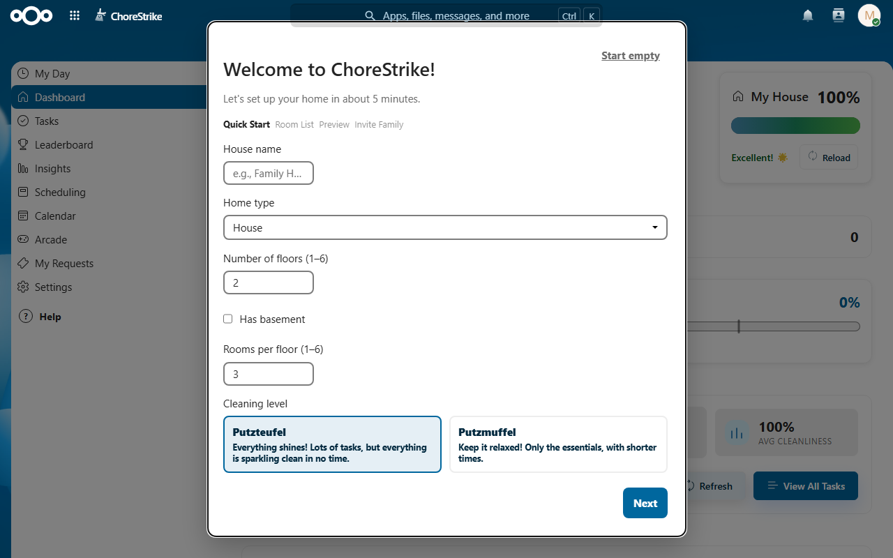
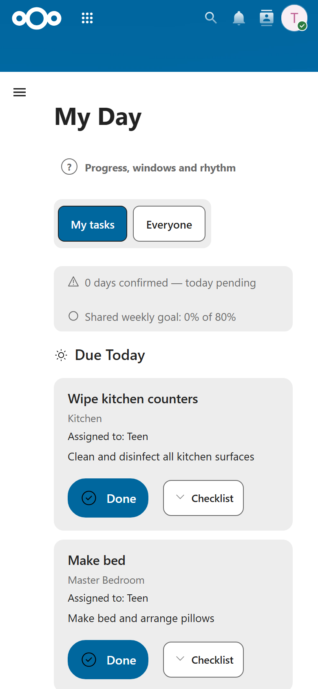
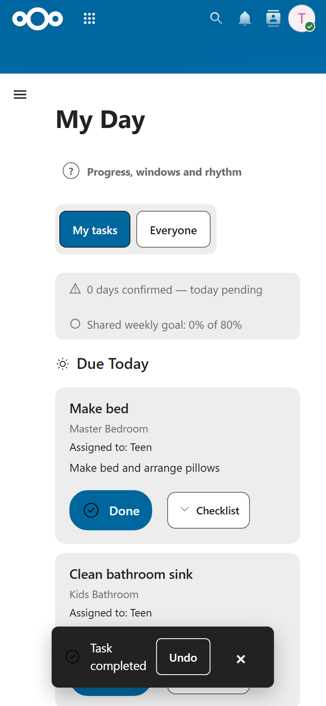
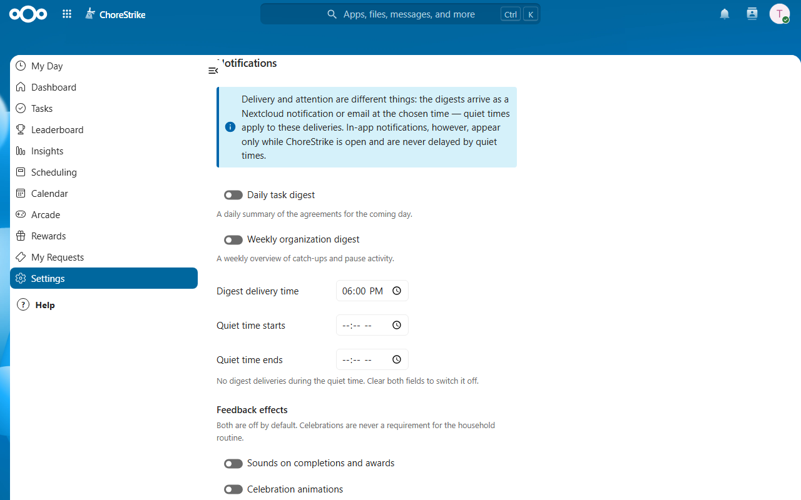

# ChoreStrike User Guide

ChoreStrike is a household task app inside your own Nextcloud. A family or a
flat shares one household: the tasks of every room, a fair plan for the week,
and a calm *My Day* list for everyone. Agreed work earns Coins; everything
else — rewards, a weekly ranking, an arcade — is optional and can stay off.

ChoreStrike follows your Nextcloud language (English or German). This guide
shows the English interface.

## Who is who

Every person in the household has one role. A household can have several
owners.

| | Owner | Member (adult) | Child |
|---|:-:|:-:|:-:|
| Complete tasks and tick checklist steps | ✓ | ✓ | ✓ |
| Own availability, pauses and notification settings | ✓ | ✓ | ✓ (pauses need an owner) |
| Create, edit and assign tasks | ✓ | ✓ | — |
| Request rewards | ✓ | ✓ | ✓ (an owner approves) |
| Invite people, change roles, remove members | ✓ | — | — |
| Set up floors and rooms, house settings, reward catalog | ✓ | — | — |
| Plan and apply the week, set others' availability and daily limits | ✓ | — | — |

Nobody can change their own role or remove themselves. An owner can remove
any other person, another owner too (for example the administrator account
that opened ChoreStrike first); the last owner cannot be demoted, so a
household always keeps an owner.

## First start

The first person who opens ChoreStrike becomes the household's owner. On the
**Dashboard**, the setup wizard opens by itself while the household has no
floors yet; you can also start it with **Set up your home**.

1. **Quick Start** — house name, home type, number of floors, basement, rooms
   per floor and the cleaning level: *Putzteufel* adds all suitable tasks at
   standard frequencies, *Putzmuffel* only the essentials, less often.
2. **Room List** — name and adjust the rooms. Room names are unique in the
   house: a name that is already taken gets a number, such as "Bedroom 2"
   (also for the hallway the wizard adds on each floor).
3. **Preview** — check the suggested tasks, then **Let's go!**
4. **Invite Family** — add the people who share the household.

**Start empty** skips the wizard; you can then create floors, rooms and tasks
yourself.

**When was it last done?** In a room, edit a task and fill in *Last done on*.
The room then shows that day as "Last cleaned", and a task that repeats after
completion is next due one interval later. It earns nothing and counts as no
completion. A newer entry corrects an older one; children cannot set it.

**Invitations.** You invite people by the email address of their existing
account on your Nextcloud — ChoreStrike sends no email; the person is part of
the household right away and sees it the next time they open the app. People
invited in the wizard start as members; choose *Owner*, *Member* or *Child* in
**Settings → Members**. Nobody can join without an invitation: anyone else
sees "You are not a member of this household yet".

## Every day: My Day

*My Day* opens first. It shows what you agreed to do:

- **Catch-up** — agreed tasks from earlier days that are still open, with an
  honest date for catching up.
- **Due Today** — today's tasks. Below them, **Also possible today** lists
  tasks planned for another day whose flex days include today; Done counts
  them on time.
- **Next appointments** — what comes up next, with a link to the room.

The line above the list shows how many days in a row you confirmed and the
household's shared weekly goal. **My tasks** and **Everyone** switch between
your own tasks and the whole household's.

| | |
|:-:|:-:|
|  |  |
| My Day on a phone | Right after completing: undo |

**Completing a task.** Press and hold **Done** for 0.6 seconds until the ring
is full (with a keyboard: hold Enter or Space). A short tap only explains the
hold, so a task is never completed by accident. If several people worked on
it, ChoreStrike asks **Who did the work?** — the shares add up to 100 %.

**Undo.** The *Task completed* message offers **Undo** for about five seconds.
Later, **Insights** lists the completion with **Undo** and **Correct split**
for the person who completed it and for owners.

**Checklists.** If a task has steps, **Checklist (2/5)** opens them; tick each
step as you go. Owners edit the steps in the task.

## Planning the week

In **Scheduling**, everyone sets **My Availability** (the days you can help)
and an energy budget for a day. Owners then plan the week:

1. **Plan the week** — pick the start day and the tasks to plan.
2. **Preview plan** — ChoreStrike proposes who does what on which day, based
   on availability, energy budgets and fairness. Tasks without a possible day
   in this window are listed separately.
3. **Adjust** — change *Person* or *Day* of any proposal.
4. **Agree and apply** — tick *Everyone affected has agreed to this plan* and
   choose **Apply plan**. Nothing changes before that.

The capacity overview shows each day's planned load against everyone's budget,
and *Overloaded days ahead* warns early. An owner can give a child a **daily
task limit**; it caps what the child sees in *My Day*.

## Optional features

### Coins and rewards

Agreed work earns **Coins**: 10 per energy unit of the task, split by the
shares of everyone who did it. Nothing is ever taken away as a punishment; an
undo or a corrected split adjusts the Coins of that completion.

- The **reward catalog** is off until an owner switches it on in **Settings**
  and adds rewards with Coin prices. Each person can still hide it with
  **Show the reward catalog** in their own settings.
- **Requesting** a reward reserves its Coins. A child's request waits for an
  owner's approval; an owner confirms the delivery for a child, adults confirm
  their own. A request can be cancelled until it is delivered.
- **My Requests** always stays in the navigation, even when the catalog is
  hidden.

### Weekly ranking

The ranking is off unless an owner switches it on, and then each person
decides for themselves with **Join next week**; it counts from the following
Monday, and **Withdraw participation** ends it. It compares only the on-time
share of public tasks, and only of people who joined.

### Notifications, sounds and celebrations

Everything here is off by default and personal — owners cannot change it for
others.

- **Daily task digest** and **Weekly organization digest** arrive as a
  Nextcloud notification at your delivery time (and by email if your Nextcloud
  forwards notifications), at most once a day. They contain counts, never task
  details.
- **Quiet time** holds deliveries back during the hours you choose.
- **Sounds** and **celebration animations** can be switched on; your device's
  reduced-motion setting always wins.

### Pauses

Ill, travelling or simply too much at once? **Request a pause** in
**Settings** with a start and end day and a reason. Adults' pauses apply right
away; a child's pause waits for an owner. Owners can also pause the whole
household and record an illness afterwards. Pauses and free days never count
against anyone.

### Arcade

A small arcade for a break with five household games: Spot Sprint, Sock
Match, Crumb Snake, Tile Breaker and Dust Runner. It is optional — **Show the
arcade** in your settings hides it — and keeps scores only: no Coins, no
boosts and no advantage in planning. Every game has its own highscores.

Spot Sprint is always open; the other games open once you have finished 3,
10, 25 or 50 chores (helping on a chore counts too). Owners can open every
game for everyone by switching off **Unlock games with finished chores**
under **Settings → Arcade**.

Every game's start screen has **Sound** and **Effects** switches. They are
the same personal settings as under *Notifications, sounds and celebrations*
(both off by default), so sounds, sparkles and the floating score stay a
choice; your device's reduced-motion setting always wins.

## Privacy

- Everything stays in your own Nextcloud; ChoreStrike uses no external
  service and sends no email itself.
- Each task is **Public** (the whole household), **Private** (its creator and
  assignees; owners do not see it) or **Admins only** (owners).
- Digests contain counts only; the ranking lists only people who joined.

## Help and troubleshooting

- **Help** in the navigation opens a short glossary; the **?** buttons next to
  headings explain that topic.
- **"You are not a member of this household yet"** — ask an owner to invite
  you with the email address of your Nextcloud account.
- **No setup wizard** — open the **Dashboard**; while the household has no
  floors, owners can start it with **Set up your home**.
- **An error message** about completing, undoing or a checklist ends with a
  short reference in brackets, such as *(CONFLICT)*, *(HTTP 500)* or
  *(NETWORK)*. Mention it when you report the problem.

Report bugs and ideas in the
[issue tracker](https://github.com/ChoreStrike/ChoreStrike/issues) — never
include passwords or real household data. Report security problems privately
as described in the [security policy](SECURITY.md). Ask questions in
[GitHub Discussions](https://github.com/ChoreStrike/ChoreStrike/discussions/categories/q-a).
