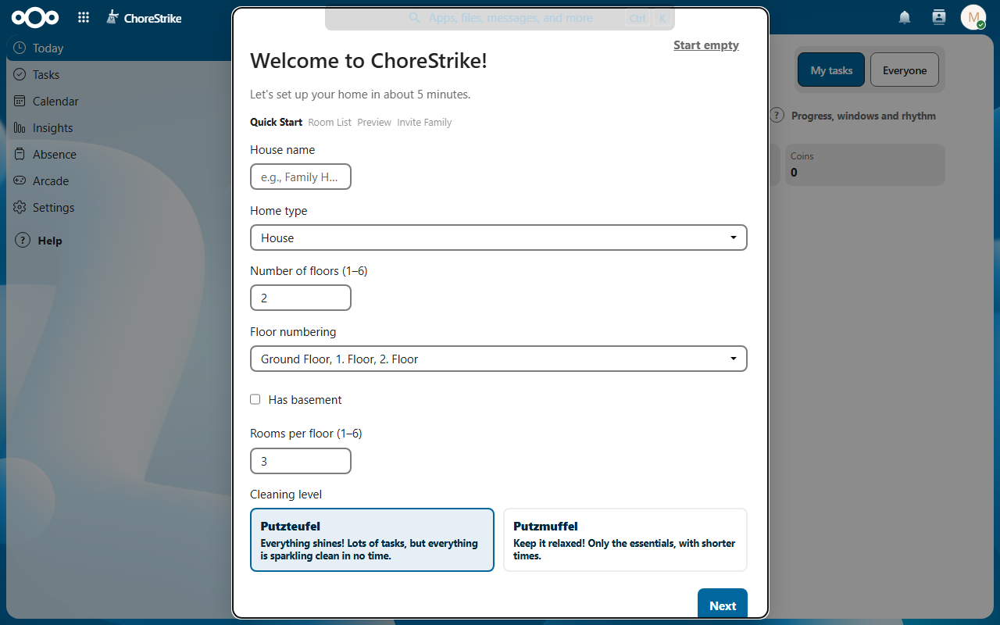
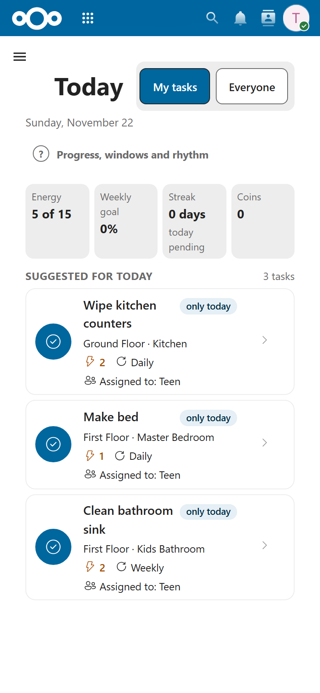
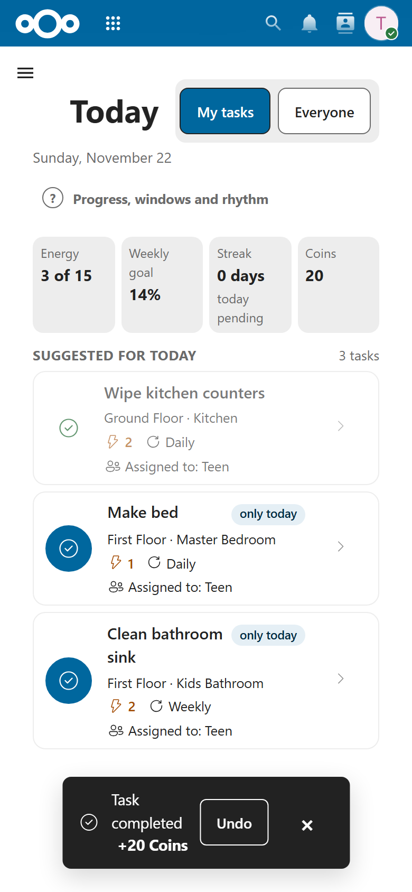
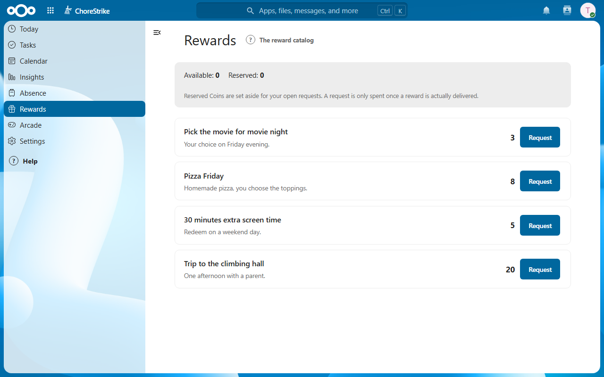
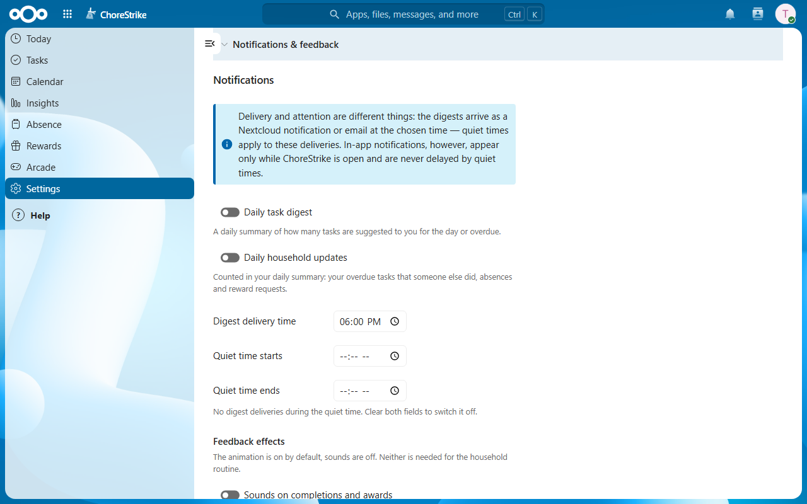

# ChoreStrike User Guide

ChoreStrike is a household task app inside your own Nextcloud. A family or a
flat shares one household: the tasks of every room, a fair plan for the week,
and a calm *Today* page for everyone. Agreed work earns Coins; everything
else — rewards, a weekly ranking, an arcade — is optional and can stay off.

ChoreStrike follows your Nextcloud language (English or German). This guide
shows the English interface.

## Who is who

Every person in the household has one role. A household can have several
owners.

| | Owner | Member (adult) | Child |
|---|:-:|:-:|:-:|
| Complete tasks and tick checklist steps | ✓ | ✓ | ✓ |
| Own availability, absences and notification settings | ✓ | ✓ | ✓ |
| Create, edit and assign tasks | ✓ | ✓ | — |
| Request rewards | ✓ | ✓ | ✓ (an owner approves) |
| Invite people, change roles, remove members | ✓ | — | — |
| Set up floors and rooms, house settings, reward catalog | ✓ | — | — |
| Plan and apply the week, set others' availability and daily limits | ✓ | — | — |

Nobody can change their own role or remove themselves. An owner can remove
any other person, another owner too (for example the administrator account
that opened ChoreStrike first); the last owner cannot be demoted, so a
household always keeps an owner.

## First start

The first person who opens ChoreStrike becomes the household's owner. On
**Today**, the setup wizard opens by itself while the household has no
floors yet; you can also start it with **Set up your home**, there or under
**Settings → Household → Floors & Rooms**.

1. **Quick Start** — house name, home type, number of floors, floor numbering, basement, rooms
   per floor and the cleaning level: *Putzteufel* adds all suitable tasks at
   standard frequencies, *Putzmuffel* only the essentials, less often.
2. **Room List** — name and adjust the rooms. Room names are unique in the
   house: a name that is already taken gets a number, such as "Bedroom 2"
   (also for the hallway the wizard adds on each floor).
3. **Preview** — check the suggested tasks, then **Let's go!**
4. **Invite Family** — add the people who share the household.

**Start empty** skips the wizard; you can then create floors, rooms and tasks
yourself.

**When was it last done?** In **Tasks**, open a task's details, choose *Date* and fill in
*Last done on*. The room then shows that day as "Last cleaned", and a task that repeats after
completion is next due one interval later. It earns nothing and counts as no
completion. A newer entry corrects an older one; children cannot set it.

**Invitations.** You invite people by the email address of their existing
account on your Nextcloud — ChoreStrike sends no email; the person is part of
the household right away and sees it the next time they open the app. People
invited in the wizard start as members; choose *Owner*, *Member* or *Child* in
**Settings → Household → Members**. Nobody can join without an invitation: anyone else
sees "You are not a member of this household yet".

## Every day: Today

*Today* opens first. At the top stands your own status: the energy of your
open work against your energy for the day, the household's shared weekly
goal, how many days in a row you confirmed, and your Coins. Below it:

- **Overdue** — agreed tasks from earlier days that are still open, in a red
  block with the date they were planned for and the days since.
- **Due Today** — today's tasks.
- **Also possible today** — one line that opens the tasks planned for another
  day whose flex days include today; Done counts them on time.

What comes up later is in the **Calendar**. **My tasks** and **Everyone**
switch between your own tasks and the whole household's; your status stays
about you.

| | |
|:-:|:-:|
|  |  |
| Today on a phone | Right after completing: undo |

**Tasks** is the one list of everything. Its switch groups it *By due date*, *By room* or
*By person*. By room, each floor is a heading and each room a row with its open and overdue
tasks, how clean it is and when it was last cleaned; a tap opens the room, and **New** in
that row adds a task to it, starting with suggestions that fit the room.

**Categories.** Each task has a category, chosen in the task form. Owners keep the list
under **Settings → Household → Task categories**: add, rename, reorder and delete
categories. *Other* always stays last and collects every task without a fitting category;
a task whose category was deleted counts as *Other* until someone gives it a new one. In
**Tasks**, the filters include **Category**.

Every task shows the same facts on *Today* and in **Tasks**: below its
name stand the floor and room, then its energy, how often it repeats and who
does it. *Every 3 days ±2* means every three days, with two flex days either
way.

**Completing a task.** Press and hold **Done** (on *Today* the round check
button) for 0.6 seconds until the ring is full (with a keyboard: hold Enter or
Space). That completes everything at once: the task with all its steps, for
the people it is assigned to, or for you when it is nobody's. So a task is
never completed by accident.

**Who did it?** A short tap on **Done** opens **Who did the work?** instead.
Tick everyone who did it; their shares are equal unless you change them, and
add up to 100 %. You can record a task for someone else without ticking
yourself. The steps of the task are there too: tick the ones that are done and
close the dialog to keep the task open, or press **Done** to complete it with
all of them.

**Postpone.** In **Tasks**, open a task with its arrow. **Postpone** moves its
due window by half its flex days, up to three times; the button shows how
often that is still possible. A postponed task still counts as on time. A task
without flex days and a task that is already overdue cannot be postponed.

**History and corrections.** The opened task lists who did it when. Your own
latest entry offers **Change date**, when the work was done on another day, and
**Delete**, when it was not done after all; the date decides when the task is
due next. Owners can change and delete every entry, and only they change the
people of an entry (**Correct split** in **Insights**).

**Undo.** The *Task completed* message offers **Undo** for about five seconds.

**Recent activity.** **Insights** lists the completions of the household and,
between them, every postponement, changed date, deleted entry and absence.
Nobody has to ask first: everyone can see what happened.

**Checklists.** If a task has steps, **Checklist (2/5)** opens them; tick each
step as you go. Owners edit the steps in the task.

## Planning the week

Under **Settings → Planning**, everyone sets **My Availability** (the days you
can help) and an energy budget for a day. Nobody applies a plan any more: what
is due follows from each task's rhythm and from when it was last done.

Open the **Calendar** and choose **Weekly plan** for the capacity overview: it
shows each day's planned load against everyone's budget, and *Overloaded days
ahead* warns early. A full day refuses nothing; work can always be recorded.
An owner can give a child a **daily task limit**; it caps the unassigned tasks
a child is offered on *Today*, never their own.

Each unit of **energy** stands for about 10 minutes of work. The task dialog
lists 1 to 5; **Longer task** takes up to 20. A changed energy applies at once
to everything still open, overdue tasks included. Completed work keeps its value.

## Optional features

### Coins and rewards

Agreed work earns **Coins**: 10 per energy unit of the task, split by the
shares of everyone who did it. Nothing is ever taken away as a punishment; an
undo or a corrected split adjusts the Coins of that completion.

- The **reward catalog** is off until an owner switches it on under
  **Settings → Household → Rewards** and adds rewards with Coin prices. Each person can still hide it with
  **Show the reward catalog** in their own settings.
- **Requesting** a reward reserves its Coins. A child's request waits for an
  owner's approval; an owner confirms the delivery for a child, adults confirm
  their own. A request can be cancelled until it is delivered.
- **My Requests** opens from **Rewards** and always from your **Settings**,
  even when the catalog is hidden.

### Weekly ranking

The ranking is a section of **Insights**. It is off unless an owner switches it
on under **Settings → Household → House**, and then each person decides for
themselves with **Join next week**; it counts from the following
Monday, and **Withdraw participation** ends it. It compares only the on-time
share of public tasks, and only of people who joined.

### Notifications, sounds and celebrations

**Settings** has two areas. *Personal* is what you decide for yourself: your
title, notifications and feedback, the appearance, your planning, and the way
to your reward requests. *Household* is for owners: house, members, floors and
rooms, task categories, rewards, arcade and the danger zone. Every category
opens with a tap.

**Appearance** picks the accent colour of the app for you alone: *Standard*
(the colour of your Nextcloud) or Ocean, Forest, Sunset, Berry or Slate. It
changes buttons, highlights, progress, the energy value and the celebration,
and follows you to every device. Backgrounds and text keep your Nextcloud
theme, light or dark. With a high-contrast Nextcloud theme the app keeps the
standard colours.

Everything under *Notifications & feedback* is personal — owners cannot change
it for others. The digests and sounds are off by default; the celebration
animation is on.

- **Daily task digest** and **Weekly organization digest** arrive as a
  Nextcloud notification at your delivery time (and by email if your Nextcloud
  forwards notifications), at most once a day. They contain counts, never task
  details.
- **Quiet time** holds deliveries back during the hours you choose.
- **Sounds** can be switched on, and the **celebration animation** can be
  switched off; your device's reduced-motion setting always wins. Finishing a
  chore always shows a short confirmation, with the Coins it earned you.

### Absence

Away, ill or simply out for a few days? Open **Absence**, pick the first and
the last day and choose **Enter**. That is all: no reason and no request, for
children as well, and it counts at once. Nothing is planned for you during
that time, and absences and free days never count against anyone.

Everyone sees all entries. You can delete your own entry as long as it has
not ended; today stays as it is, and from tomorrow the days count as usual
again. Owners can delete any entry, enter an absence for the whole household
and enter one for someone afterwards, for days that have already passed.

### Arcade

A small arcade for a break with five household games: Spot Sprint, Sock
Match, Crumb Snake, Tile Breaker and Dust Runner. It is optional — **Show the
arcade** in your settings hides it — and keeps scores only: no Coins, no
boosts and no advantage in planning. Every game has its own highscores.

Unless an owner changes it, Spot Sprint is always open and the other games
open once you have finished 3, 10, 25 or 50 chores (helping on a chore counts
too). Owners manage this under **Settings → Household → Arcade**:

- **Unlock games with finished chores** switched off opens every game for
  everyone.
- **Finished chores per game** sets how many chores open each game, from 0
  (open right away) to 500.
- **Start over** resets one person after a confirmation: the games lock again
  for them and open with chores they finish after the reset. Their
  highscores stay, and the list shows each person's finished chores since
  their last reset.

Every game's start screen has **Sound** and **Effects** switches. They are
the same personal settings as under *Notifications, sounds and celebrations*
(sound off, effects on by default), so sounds, sparkles and the floating
score stay a choice; your device's reduced-motion setting always wins.

## Privacy

- Everything stays in your own Nextcloud; ChoreStrike uses no external
  service and sends no email itself.
- Each task is **Public** (the whole household), **Private** (its creator and
  assignees; owners do not see it) or **Admins only** (owners).
- Digests contain counts only; the ranking lists only people who joined.

## Help and troubleshooting

- **Help** in the navigation opens a short glossary; the **?** buttons next to
  headings explain that topic.
- **"You are not a member of this household yet"** — ask an owner to invite
  you with the email address of your Nextcloud account.
- **No setup wizard** — open **Today**; while the household has no
  floors, owners can start it with **Set up your home**.
- **An error message** about completing, undoing or a checklist ends with a
  short reference in brackets, such as *(CONFLICT)*, *(HTTP 500)* or
  *(NETWORK)*. Mention it when you report the problem.

Report bugs and ideas in the
[issue tracker](https://github.com/ChoreStrike/ChoreStrike/issues) — never
include passwords or real household data. Report security problems privately
as described in the [security policy](SECURITY.md). Ask questions in
[GitHub Discussions](https://github.com/ChoreStrike/ChoreStrike/discussions/categories/q-a).
